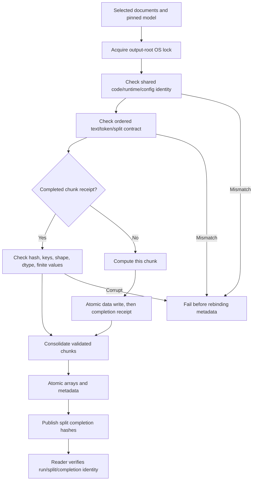

# Making a research result inspectable and an extraction run safe to resume

This project compares chess move behavior and inspects real open-weight transformer internals. The redevelopment concentrates on two engineering boundaries: whether a reviewer can independently recompute a reported result, and whether an interrupted representation extraction can resume without mixing vectors and metadata from different runs.

This is an independent research prototype. The Regan-inspired reconstruction is not Professor Regan's production system. Maia is a human-move transformer. Full held-out Qwen chess scoring remains pending. The security labs are synthetic teaching simulations. No result proves that a real player cheated or that a text was AI-authored.

## The defects

**Evidence:** a fresh clone contained published result summaries and saved Maia scores, but ignored files needed by the full hybrid script were missing. Running an unrelated test subset or loading a summary JSON was not independent reproduction.

**Resume:** the extractor skipped numbered chunks by existence and rewrote metadata before checking the selected source identity. A deterministic CLI fixture changed one document, reran into the same output directory, and demonstrated unchanged stale vectors under changed metadata; a clean run on the changed source produced different vectors. This fixture exercised orchestration with test doubles, not a language model.

**Cross-split consistency:** an additional adversarial fixture showed that a newly added split could use a different numerical runtime while joining an existing representation run. Per-split checks alone did not protect the full train/validation/test run.

These failures demonstrate unsafe behavior in the old code. They do not establish that an existing published experiment actually encountered it; historical results are preserved and qualified.

## Design

An output-root OS lock serializes writers and releases on process death. Shared configuration, numerical runtime, execution device and code identities cannot drift across splits. Each split also binds ordered selected document metadata, SHA-256 text/token identities and chunk layout. Changed selected content, batch/chunk boundaries or precision fails before metadata is rebound.

Chunks become complete only after data and a matching receipt are published. Reuse checks the recorded contract, input identity, hash, exact array keys/shapes/dtypes and valid values. Disabled NLL has an explicit all-NaN sentinel. An orphan data file without a receipt is unfinished and recomputed; a completed corrupt chunk fails. Consolidated arrays and metadata receive a separate completion marker; new-format readers reject incomplete or mismatched runs. Extraction errors still clean up the adapter.

The CPU evidence gate independently recomputes four Maia metrics and their intervals from committed score rows. A separate optional command uses explicitly provided frozen split/variant/prediction files to reproduce five hybrid ROC-AUC points and seven paired intervals. It uses a separately tested weighted pair-ordering AUC with tie handling, preserving paired source-game bootstrap units and the source seed/order. It does not rerun inference.

## Why these alternatives

| Alternative | Decision |
| --- | --- |
| Keep filename-based skipping | Rejected: existence does not identify source content or prove a complete write. |
| Rerun every extraction from zero | Valid simple fallback, retained by choosing a new output folder; unnecessarily expensive after an interrupted long run. |
| One global configuration JSON | Insufficient alone: it does not bind selected ordered documents, tokenization, chunk layout or completed chunk integrity. |
| Adopt old chunks and infer their provenance | Rejected: original identity cannot be recovered reliably from array shape. Use a new directory; historical read support is separately qualified. |
| Introduce Temporal, a database or a distributed scheduler | Deferred: this defect is a local batch-artifact boundary. An OS lock and atomic publication fit the existing architecture with less operational machinery. |
| Report summaries as reproduction | Rejected: the verifier must recalculate supported values from saved scores and fail on missing evidence. |

## Evidence and release interpretation

Pre-implementation contracts: `cpu-evidence-contract.md`, `full-cpu-evidence-contract.md`, and `extraction-resume-contract.md`. Reproduction commands and qualifications: `cpu-verification.md` and `extraction-checkpoints.md`. Tests under `tests/cpu_verify` run with only NumPy/PyArrow/pytest; real cached-model tests under `tests/latentlens` use their separately pinned research environment and offline checkpoints. CI workflows are prepared; local success does not establish remote CI success.

The saved evidence reproduces 12,863 paired Maia positions, and optionally 9,680 hybrid prediction rows from 321 held-out source games. Recorded split identities cover 47,360 variants, 1,561 games and 2,960 player identifiers. These are account/metadata consistency checks, not independent identification of humans or prospective cheating labels. Exact numerical reports and source/runtime hashes belong to the release evidence packet; no speedup or new model-quality gain is claimed.

The application retains the UI from the actual deployed `latentlens-storybook` revision, rather than replacing it with an older default-branch UI. Clean installation and fresh-checkout route type generation are checked. This host's Turbopack CSS worker failed; the supported Webpack builder passed with normal TypeScript checks. The default Linux/Vercel builder remains unchanged, and its actual deployment result must be reported separately.

## Limits and next decisions

Coordination assumes a single host and normal filesystem locking/atomic-replace semantics. File flush/fsync and rename do not guarantee that every directory entry survives sudden power loss. Hashes detect accidental drift; they do not authenticate results against an authorized operator rewriting both artifacts and receipts. Consolidation still loads arrays in memory. GPU capacity, production serving throughput, forward-pass regeneration of all scientific results and full Qwen held-out performance are not established by this work.

Future work needs a demonstrated task and a falsifiable comparison. No memory database, agent router, live browser fallback or DPO loop is needed to fix this research pipeline. A technical explanation of this boundary is useful evidence; adding frameworks without such a boundary is not.
